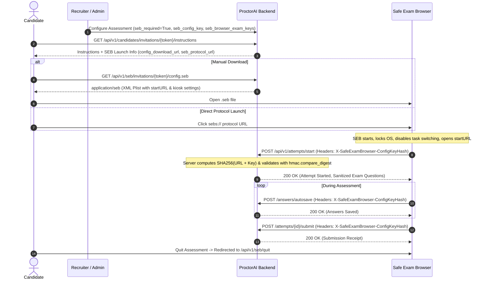

# ProctorAI Safe Exam Browser (SEB) High-Security Mode: Architecture & Security Verification

## 1. Executive Summary

ProctorAI provides two distinct operating modes for exam delivery:
1. **Standard Browser Mode (Webcam & Explainable Rule Monitoring):** Employs standard browser APIs (HTML5 Fullscreen, `visibilitychange`, devtools detection, webcam presence monitoring). **This mode operates strictly within standard browser sandbox boundaries and does NOT claim operating-system-level kiosk lockdown.**
2. **High-Security Safe Exam Browser (SEB) Mode:** Cryptographically verified kiosk lockdown using the open-source **Safe Exam Browser (SEB)** ecosystem. In this mode, candidate workstations are locked at the OS level (disabling task switching, virtual machines, secondary monitors, screen capture, and unauthorized processes).

> [!IMPORTANT]
> **Strict Threat Boundary Principle**: Ordinary browser JavaScript, User-Agent strings, and URL query parameters (e.g., `?seb=true`) are trivial to forge and are **never** treated as proof of client integrity. Only cryptographically verified request hashes computed over server-held secret keys are accepted as evidence of a genuine SEB session.

---

## 2. Supported Client Verification Mechanisms

Safe Exam Browser (SEB) supports two cryptographic keys for server-side verification:

### A. Config Key (CK)
- **Definition:** A SHA-256 hash calculated exclusively from the canonical XML/JSON settings dictionary of the active `.seb` configuration file.
- **Cross-Platform Property:** The same configuration file generates an identical Config Key across Windows, macOS, and iOS, regardless of SEB application binary version.
- **Verification Header:**
  $$\text{X-SafeExamBrowser-ConfigKeyHash} = \text{SHA256}(\text{Absolute Target URL} + \text{Config Key})$$
- **Usage in ProctorAI:** Recommended for multi-platform cohorts where candidate device OS versions vary, but identical exam policies are enforced.

### B. Browser Exam Key (BEK)
- **Definition:** A cryptographic hash combining both the configuration file settings *and* the code signature of the specific SEB client executable build.
- **Platform-Specific Property:** The Browser Exam Key changes between Windows, macOS, and iOS, and updates with every official SEB binary release.
- **Verification Header:**
  $$\text{X-SafeExamBrowser-RequestHash} = \text{SHA256}(\text{Absolute Target URL} + \text{Browser Exam Key})$$
- **Usage in ProctorAI:** Used when institutions mandate a verified, unmodified binary build for specific operating systems. ProctorAI supports registering multiple platform BEKs per assessment (e.g., Windows BEK and macOS BEK).

### C. Modern WebKit / WKWebView JavaScript API Bridge
- **WebKit Limitation:** Modern macOS and iOS clients running Apple's `WKWebView` restrict the injection of custom HTTP request headers into subresource requests (`fetch` / XHR).
- **SEB JavaScript API:** SEB injects the `SafeExamBrowser.security` object into the window frame:
  ```javascript
  SafeExamBrowser.security.updateKeys(function() {
      const configKey = SafeExamBrowser.security.configKey;
      const browserExamKey = SafeExamBrowser.security.browserExamKey;
      // Transmitted securely via request headers or client payload
  });
  ```
- **ProctorAI Integration:** The exam frontend checks for `SafeExamBrowser.security.updateKeys()`, reads the context keys, and injects `X-SafeExamBrowser-ConfigKeyHash` or `X-SafeExamBrowser-RequestHash` onto all API calls (`/start`, `/answers/autosave`, `/state`, `/submit`).

---

## 3. Platform Compatibility Matrix & Documented Limitations

| Platform | Official SEB Support | Verification Method | Kiosk Lockdown Guarantee | Limitations / Implementation Details |
| :--- | :--- | :--- | :--- | :--- |
| **Windows 10 / 11** | **Yes** (SEB 3.x Win32/WPF + Chromium) | Config Key Hash, BEK Request Hash | **Full OS Lockdown** | Registry hooks, disable Task Manager, Alt+Tab, Win keys, dual monitor kill switch. |
| **macOS (11.0+)** | **Yes** (SEB 3.x Cocoa + WKWebView) | Config Key Hash, BEK Request Hash, JS API | **Full OS Lockdown** | Kiosk Mode API, menu bar hidden, Cmd+Tab / Exposé blocked, Siri disabled. |
| **iOS / iPadOS** | **Yes** (SEB 3.x iOS App) | Config Key Hash, JS API | **Full OS Lockdown** | Apple Single App Mode (AAC / Guided Access), screenshots & multitasking blocked. |
| **Android** | **Unsupported** | None | **None** | *Official Safe Exam Browser does not have an Android release.* Android is unsupported for high-security mode. |
| **Linux / ChromeOS** | **Unsupported** | None | **None** | *No official SEB client exists for Linux distributions.* Candidates must use Windows or macOS. |
| **Virtual Machines** | Client-side detection | BEK Code Signature + Hypervisor Detection | Partial / Client Enforced | Windows SEB blocks VMware, VirtualBox, and Hyper-V via driver checks. Remote server verifies BEK. |

---

## 4. Exam Launch & Configuration Flow



---

## 5. Security & Anti-Tampering Defenses

### A. Non-Standard Browser Rejection
If a student attempts to access a high-security assessment using Google Chrome, Firefox, Edge, or Safari:
- The server detects the absence of `X-SafeExamBrowser-RequestHash` and `X-SafeExamBrowser-ConfigKeyHash`.
- The request is immediately rejected with `HTTP 403 Forbidden`:
  ```json
  {
    "detail": {
      "code": "SEB_CLIENT_REQUIRED",
      "message": "This assessment requires Safe Exam Browser. No cryptographic verification headers were received.",
      "lockdown_guaranteed": false
    }
  }
  ```

### B. Header & Hash Spoofing Defense
- If a candidate creates a proxy or uses curl to send `User-Agent: SEB/3.0` or custom query strings `?seb=true`:
  - The server ignores query parameters and User-Agent as proof of identity.
  - The server recalculates `SHA256(request_url + key)` against the server's secret Config Key.
  - If the hash is invalid or missing, it fails with `SEB_HASH_MISMATCH` or `SEB_CLIENT_REQUIRED`.

### C. Timing Attack Mitigation
All cryptographic hash comparisons utilize Python's `hmac.compare_digest`:
```python
hmac.compare_digest(incoming_hash.lower(), expected_hash.lower())
```
This guarantees constant-time evaluation and eliminates timing side-channel attacks aimed at brute-forcing hash characters.

### D. Reverse-Proxy & Port Canonicalization
Server-side verification normalizes URL candidates (handling scheme toggles `http`/`https` and default ports `:80`/`:443`) to prevent false rejections when behind reverse proxies (Nginx, Traefik, AWS ALB) while preserving exact cryptographic matching.

---

## 6. Verifiable Evidence Captured on Candidates

When an attempt is launched in SEB mode, ProctorAI records immutable evidence in the database:
- `attempt.seb_verified`: Boolean (`True`)
- `attempt.seb_verification_mechanism`: String (`CONFIG_KEY_HASH` or `BEK_REQUEST_HASH`)
- `attempt.seb_verified_at`: UTC Timestamp of initial verification
- `attempt.seb_client_platform`: Detected client OS (`Windows`, `macOS`, or `iOS`)
- `attempt.seb_client_user_agent`: Recorded user agent string for audit logging
